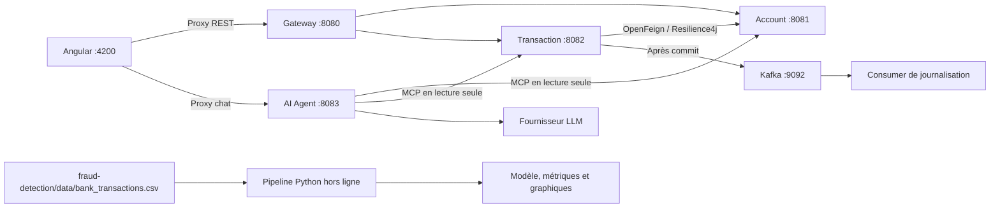

# ADRIA Banking Platform — ENSET PFE 2027

Plateforme bancaire de démonstration composée de six microservices Spring Boot, d'une interface Angular et d'un pipeline Python de détection de fraude. Ce README décrit les fonctionnalités présentes dans le code source et la configuration du dépôt.

## Fonctionnalités

- **Comptes** : création, consultation, recherche par référence client, solde, débit/crédit et blocage/déblocage.
- **Transactions** : achats par débit, historique, virements entre deux comptes et suivi/réconciliation des opérations idempotentes.
- **Infrastructure** : découverte Eureka, configuration centralisée, Gateway et événements Kafka après confirmation des transactions.
- **Consultation bancaire** : API GraphQL, serveurs MCP et assistant IA en lecture seule.
- **Interface web** : tableau de bord, comptes, transactions, virements et chat, avec gestion des chargements, erreurs et reprises d'opérations.
- **Fraude** : entraînement et évaluation hors ligne d'une régression logistique sur `fraud-detection/data/bank_transactions.csv`. Ce pipeline est indépendant des services Java et du frontend.

## Architecture et technologies



Eureka fournit le registre utilisé par Gateway et par les appels Feign sans URL directe. Config Server sert les propriétés partagées depuis `config-service/src/main/resources/config-repo/`, dont `bank.transaction.max-amount=1000`.

| Composant | Port par défaut | Rôle / point d'accès |
| --- | --- | --- |
| `discovery-service` | 8761 | Registre Eureka : `http://localhost:8761/` |
| `config-service` | 8888 | Config Server natif : `/transaction-service/default` |
| `account-service` | 8081 | REST `/api/accounts`, GraphQL `/graphql`, MCP `/mcp` |
| `transaction-service` | 8082 | REST `/api/transactions`, GraphQL `/graphql`, MCP `/mcp` |
| `gateway-service` | 8080 | Routes REST vers Account et Transaction via Eureka |
| `ai-agent-service` | 8083 | Assistant : `POST /api/chat` |
| `banking-web` | 4200 | Application locale : `http://127.0.0.1:4200/` |
| Kafka | 9092 | Broker local fourni par Docker Compose |

Versions déclarées dans les fichiers du projet :

| Couche | Technologies |
| --- | --- |
| Backend | Java 21, Spring Boot 3.5.16, Spring Cloud 2025.0.3, Spring AI 1.1.8 |
| Données et intégrations | Spring Data JPA, H2, OpenFeign, OkHttp, Resilience4j, Spring Kafka |
| Frontend | Angular `^21.2.0`, TypeScript `~5.9.3`, RxJS `~7.8.2`, Tailwind CSS `^4.1.0` |
| Fraude | pandas 2.2.3, NumPy 2.2.6, SciPy 1.15.3, scikit-learn 1.6.1, Matplotlib 3.10.3, joblib 1.5.1 |
| Build | Maven Wrapper 3.10.0, npm et `package-lock.json` |

## Organisation du dépôt

```text
.
├── pom.xml                         # Parent et agrégateur des six modules Java
├── account-service/                # Comptes, opérations atomiques, REST/GraphQL/MCP
├── transaction-service/            # Transactions, Feign, idempotence et Kafka
├── discovery-service/              # Serveur Eureka
├── config-service/                 # Config Server et dépôt natif embarqué
├── gateway-service/                # Gateway WebFlux
├── ai-agent-service/               # Clients MCP et assistant Spring AI
├── banking-web/                    # Application Angular standalone
├── fraud-detection/                # Pipeline Python, données, modèle et résultats
├── docker-compose.kafka.yml        # Broker Kafka local en KRaft
├── .env.example                    # Variables backend à exporter
├── scripts/                        # Vérifications HTTP PowerShell
└── docs/                           # Collections Postman
```

## Prérequis

- JDK **21** ; aucun Maven global requis grâce au Wrapper.
- Node.js **24.x** et npm pour Angular, conformément à `banking-web/package.json`.
- Docker avec moteur Linux pour le broker Kafka local.
- Python **3.12** pour reproduire l'environnement documenté du pipeline de fraude.
- Une clé fournisseur LLM uniquement pour utiliser réellement le chat IA.

Les commandes suivantes utilisent PowerShell depuis la racine du dépôt, sauf indication contraire. Sur un shell Unix, utiliser `./mvnw` et `npm` à la place de `.\mvnw.cmd` et `npm.cmd`.

## Démarrage de la plateforme

### 1. Compiler le backend

```powershell
.\mvnw.cmd clean verify
```

Cette commande compile, exécute les tests sélectionnés par Maven et produit les JAR des six services. Pour produire les JAR en sautant les tests :

```powershell
.\mvnw.cmd -DskipTests clean package
```

### 2. Démarrer Kafka

```powershell
docker compose -f docker-compose.kafka.yml up -d
docker compose -f docker-compose.kafka.yml ps
```

Attendre que Kafka soit `healthy` avant de lancer Transaction Service. Le Compose démarre uniquement Kafka (`apache/kafka:3.9.1`), sans ZooKeeper. Le service Java déclare le topic `bank.transactions.created` avec une partition et une réplique.

### 3. Démarrer les services Java

Exécuter chaque commande dans un **terminal distinct**, en attendant le démarrage d'Eureka et de Config avant les services clients :

```powershell
# Terminal 1 : découverte
java -jar .\discovery-service\target\discovery-service-0.0.1-SNAPSHOT.jar

# Terminal 2 : configuration
java -jar .\config-service\target\config-service-0.0.1-SNAPSHOT.jar

# Terminal 3 : comptes
java -jar .\account-service\target\account-service-0.0.1-SNAPSHOT.jar

# Terminal 4 : transactions
java -jar .\transaction-service\target\transaction-service-0.0.1-SNAPSHOT.jar

# Terminal 5 : Gateway
java -jar .\gateway-service\target\gateway-service-0.0.1-SNAPSHOT.jar
```

Pour les consultations MCP et le chat, définir **avant le démarrage** le même `MCP_AUTH_TOKEN` dans les terminaux Account, Transaction et AI Agent ; voir la section IA ci-dessous. Le profil `local` active GraphiQL sur Account et Transaction : ajouter `--spring.profiles.active=local` à leurs commandes.

Discovery, Config, Account, Transaction et Gateway exposent `/actuator/health` sur leur port. Attendre la propagation du registre Eureka avant d'appeler les routes de Gateway.

### 4. Démarrer Angular

```powershell
cd banking-web
npm.cmd ci
# Pour le chat : reprendre le jeton configuré dans le service agent.
$env:AGENT_AUTH_TOKEN = '<même jeton que le service agent>'
npm.cmd start
```

Ouvrir `http://127.0.0.1:4200/`. Les pages disponibles sont `/dashboard`, `/accounts`, `/transactions`, `/transfers` et `/assistant`.

Le proxy de développement envoie `/api/accounts` et `/api/transactions` vers Gateway sur **8080**, et `/api/chat` directement vers l'agent sur **8083**. Gateway ne possède actuellement aucune route vers le chat, GraphQL ou MCP. Le proxy injecte le jeton du chat côté Node ; aucune clé LLM ne doit être placée dans le code Angular.

## API bancaire et règles métier

Les routes REST ci-dessous sont accessibles via `http://localhost:8080`, ou directement sur le service concerné.

| Méthode | Chemin | Usage |
| --- | --- | --- |
| POST | `/api/accounts` | Créer un compte |
| GET | `/api/accounts` | Lister les comptes |
| GET | `/api/accounts/{id}` | Consulter un compte |
| GET | `/api/accounts/customer/{reference}` | Rechercher par référence client |
| GET | `/api/accounts/{id}/balance` | Consulter le solde |
| PATCH | `/api/accounts/{id}/debit` ou `/api/accounts/{id}/credit` | Débit/crédit direct, corps `{"amount":250}` |
| PATCH | `/api/accounts/{id}/status?status=BLOCKED` | Bloquer ; utiliser `ACTIVE` pour débloquer |
| POST | `/api/transactions` | Enregistrer un achat et débiter le compte |
| GET | `/api/transactions` | Lister les transactions |
| GET | `/api/transactions/{id}` | Consulter une transaction |
| GET | `/api/transactions/account/{accountId}` | Historique d'un compte |
| POST | `/api/transactions/transfers` | Effectuer un virement |
| GET | `/api/transactions/operations/{id}` | Consulter l'état d'une opération |
| POST | `/api/transactions/operations/{id}/reconcile` | Reprendre explicitement une opération |

Les POST d'achat et de virement de Transaction Service exigent un en-tête **`Idempotency-Key` contenant un UUID**. Réutiliser la même clé avec le même corps reprend l'opération ; un corps différent avec la même clé est rejeté avec 409. Les débits/crédits directs d'Account Service ne créent pas d'historique dans Transaction Service et n'offrent pas cette idempotence.

Les montants de Transaction Service sont strictement positifs, comportent au plus deux décimales et respectent un plafond configurable, fixé à **1 000** par défaut. Les comptes doivent être actifs, avoir une devise compatible et disposer du solde nécessaire. Les virements exigent deux comptes distincts ; les deux soldes sont modifiés dans une transaction locale atomique d'Account Service, avec verrous JPA pris dans un ordre stable.

Les reçus d'Account Service permettent de retrouver une mutation déjà validée après un timeout. Une opération restant ambiguë nécessite une reprise avec la **même clé**, ou une réconciliation. Le frontend conserve la clé et le corps dans `sessionStorage` et ne relance pas automatiquement une écriture financière.

Les erreurs REST utilisent notamment `ProblemDetail` : 400 pour une requête invalide, 404 pour une ressource absente, 409 pour un conflit métier ou concurrent et 503 pour une indisponibilité/réconciliation nécessaire.

Account Service expose aussi `PUT /api/accounts/operations/{id}` pour exécuter une opération idempotente, `GET /api/accounts/operations/{id}` pour lire son reçu et `POST /api/accounts/transfers` pour un transfert atomique avec `Idempotency-Key`. Le corps d'opération contient `type` (`DEBIT`, `CREDIT` ou `TRANSFER`), `sourceAccountId`, `destinationAccountId` pour un transfert, `amount` et `currency`.

### Exemple : compte et achat via Gateway

```powershell
$baseUrl = 'http://localhost:8080'
$account = Invoke-RestMethod -Method Post -Uri "$baseUrl/api/accounts" `
    -ContentType 'application/json' `
    -Body '{"customerReference":"DEMO-001","currency":"EUR","balance":5000}'

$operationId = [guid]::NewGuid().ToString()
$body = @{
    accountId = $account.id
    amount = 250
    currency = 'EUR'
    merchantCategory = 'FOOD'
    country = 'MA'
} | ConvertTo-Json

Invoke-RestMethod -Method Post -Uri "$baseUrl/api/transactions" `
    -ContentType 'application/json' -Headers @{ 'Idempotency-Key' = $operationId } -Body $body
Invoke-RestMethod "$baseUrl/api/accounts/$($account.id)/balance"
```

Le solde attendu est **4 750 EUR**. Répéter uniquement le POST d'achat avec `$operationId` et `$body` inchangés ne doit pas provoquer un second débit.

## GraphQL, MCP et assistant IA

Account et Transaction exposent chacun `POST /graphql` et un serveur MCP Streamable HTTP sur `/mcp`, directement sur **8081** et **8082**. Les schémas GraphQL permettent de consulter les comptes (`accounts`, `accountById`) et les transactions (`transactionById`, `transactionsByAccount`). GraphiQL est disponible sur `/graphiql` avec le profil `local`.

Les cinq outils MCP sont en lecture seule : `getAccountDetails`, `getAccountBalance`, `getAccountsByCustomerReference`, `getTransactionDetails` et `getTransactionsByAccount`.

Pour activer l'agent, exporter les variables dans les terminaux concernés. Les fichiers `.env` ne sont **pas chargés automatiquement** ; [.env.example](.env.example) décrit la configuration.

```powershell
# Dans Account, Transaction et AI Agent : même secret non vide.
$env:MCP_AUTH_TOKEN = '<secret partagé généré une seule fois>'

# Dans le terminal AI Agent uniquement :
$env:AGENT_AUTH_TOKEN = '<secret du client REST et du proxy frontend>'
$env:OPENAI_API_KEY = '<clé fournisseur>'
$env:OPENAI_MODEL = 'gpt-5-mini'
$env:ACCOUNT_MCP_URL = 'http://localhost:8081'
$env:TRANSACTION_MCP_URL = 'http://localhost:8082'
java -jar .\ai-agent-service\target\ai-agent-service-0.0.1-SNAPSHOT.jar --spring.profiles.active=llm
```

Les services MCP doivent être prêts avant le démarrage de l'agent avec `llm`. Les URLs MCP sont des URLs de base, sans `/mcp`. `OPENAI_BASE_URL` permet de remplacer l'URL du fournisseur configurée. Si `AGENT_AUTH_TOKEN` est omis, le jeton MCP est utilisé en repli. Sans profil `llm`, l'agent peut démarrer, mais un appel authentifié au chat retourne 503.

Le chat accepte `POST http://localhost:8083/api/chat`, avec `Authorization: Bearer <AGENT_AUTH_TOKEN>` et le corps `{"message":"Quel est le solde du compte UUID-DU-COMPTE ?"}`. Il retourne `{"answer":"...","toolsUsed":["..."]}` ; les outils indiqués ont réellement terminé leur exécution. Le contrat ne contient pas de session de conversation persistante. Une erreur fournisseur ou MCP pendant la consultation retourne 502.

## Détection de fraude et CSV fourni

Le fichier [bank_transactions.csv](fraud-detection/data/bank_transactions.csv), conservé uniquement dans `fraud-detection/data/`, contient **5 000 transactions**, **9 colonnes** et **257 fraudes (5,14 %)**. Son empreinte SHA-256 est :

```text
4c74c38b646e10303f52e32673a4a2882a5d3c964e29b3c446866570f7124c24
```

| Colonnes | Utilisation dans le pipeline |
| --- | --- |
| `transaction_id`, `account_id` | Identifiants exclus de l'apprentissage |
| `amount`, `hour`, `transactions_last_24h`, `average_amount_last_7d` | Variables numériques : imputation médiane et normalisation |
| `country`, `merchant_category` | Variables catégorielles : imputation majoritaire et encodage one-hot |
| `is_fraud` | Cible binaire : 0 = légitime, 1 = fraude |

Valeurs manquantes observées : **66** pour `country`, **84** pour `merchant_category` et **75** pour `average_amount_last_7d`. Les autres colonnes sont complètes.

Le script utilise une séparation stratifiée **80 % / 20 %**, `random_state=42`, puis un `Pipeline` scikit-learn avec `LogisticRegression(class_weight="balanced", max_iter=1000)`. Le prétraitement est ajusté uniquement sur l'entraînement ; le seuil de décision est fixé à **0,5**.

Pour exécuter le pipeline directement sur le CSV fourni, depuis la racine :

```powershell
python -m venv fraud-detection/.venv
.\fraud-detection\.venv\Scripts\python.exe -m pip install -r fraud-detection/requirements.txt
.\fraud-detection\.venv\Scripts\python.exe fraud-detection/fraud_detection.py --data fraud-detection/data/bank_transactions.csv
```

Les sorties sont enregistrées sous `fraud-detection/models/` et `fraud-detection/results/` : pipeline `fraud_pipeline.joblib`, métriques JSON, rapport de classification et trois graphiques (classes, matrice de confusion, courbe précision-rappel). Une nouvelle exécution remplace ces sorties ; `--output-dir <dossier>` permet de choisir une autre destination.

Les résultats déjà enregistrés dans [metrics.json](fraud-detection/results/metrics.json), sur **1 000 transactions de test dont 51 fraudes**, sont :

| Mesure | Valeur |
| --- | ---: |
| Précision fraude | 0,122137 |
| Rappel fraude | 0,627451 |
| F1 fraude | 0,204473 |
| Average precision | 0,188605 |
| Fraudes détectées / manquées | 32 / 19 |
| Fausses alertes | 230 |

Ces résultats décrivent cet échantillon et montrent une faible précision des alertes. Le CSV ne documente pas son origine et ne contient pas de date complète permettant une validation chronologique. Le pipeline ne consomme pas les événements Kafka et n'expose aucun endpoint de prédiction.

L'accuracy seule est insuffisante sur ces classes déséquilibrées : prédire systématiquement « légitime » donnerait 94,9 % d'accuracy sur le test, mais ne détecterait aucune fraude. Le choix du seuil doit tenir compte des faux positifs, des fraudes manquées et des coûts métier, sur une validation distincte du test final. Les agrégats doivent être construits uniquement à partir d'événements antérieurs à la décision ; leur provenance n'est pas vérifiable dans ce CSV. Exclure `account_id` des variables ne garantit pas non plus l'indépendance des comptes entre entraînement et test.

## Tests et vérifications

```powershell
# Tests du backend
.\mvnw.cmd clean verify
# Tests ciblés avec les dépendances du module
.\mvnw.cmd -pl account-service,transaction-service -am test

# Compilation de production Angular, depuis banking-web/
npm.cmd run build
```

Les tests Java couvrent notamment les validations, les soldes, la concurrence, les virements atomiques, l'idempotence, les erreurs HTTP Feign et la reprise après timeout. Les rapports Maven sont écrits dans `<module>/target/surefire-reports/`.

Après démarrage des services requis, les scripts suivants exécutent des contrôles HTTP. Ceux des comptes, transactions et de l'étape 6 créent des données de démonstration :

| Commande depuis la racine | Services requis |
| --- | --- |
| `powershell -NoProfile -ExecutionPolicy Bypass -File scripts/test-account-service.ps1` | Account |
| `powershell -NoProfile -ExecutionPolicy Bypass -File scripts/test-transaction-service.ps1` | Account et Transaction |
| `powershell -NoProfile -ExecutionPolicy Bypass -File scripts/test-cloud-services.ps1` | Eureka, Config, Gateway, Account et Transaction |
| `powershell -NoProfile -ExecutionPolicy Bypass -File scripts/test-step6.ps1` | Account, Transaction et agent sans LLM ; jetons configurés |
| `powershell -NoProfile -ExecutionPolicy Bypass -File scripts/test-step6.ps1 -TestLlm` | Même ensemble avec agent en profil `llm` et fournisseur configuré |

Le test HTTP réel `McpClientConfigurationIT` se lance explicitement avec `-pl ai-agent-service '-Dtest=McpClientConfigurationIT' test`. Il nécessite `MCP_AUTH_TOKEN`, les deux serveurs MCP et `STEP6_ACCOUNT_ID` correspondant au compte de démonstration à **4 749,75 EUR** créé par `test-step6.ps1` ; il ne fait pas partie de la sélection habituelle des tests Surefire.

Les commandes de vérification doivent être exécutées dans l'environnement concerné pour confirmer le fonctionnement. Une compilation seule ne valide pas un parcours complet navigateur → backend → LLM.

## Persistance, sécurité et limites actuelles

- Account et Transaction utilisent des bases H2 **en mémoire**, avec `create-drop` : comptes, transactions et reçus d'idempotence sont perdus au redémarrage. Les consoles locales sont sur `/h2-console`, avec utilisateur `sa`, mot de passe vide et URL JDBC `jdbc:h2:mem:accountdb` ou `jdbc:h2:mem:transactiondb`.
- Le solde Account reste persisté en `double`, malgré les calculs intermédiaires en `BigDecimal` ; les opérations idempotentes rejettent les mutations incompatibles avec les contrôles de représentation du modèle existant.
- Les filtres protègent `/mcp` et `/api/chat` par jeton Bearer : jeton non configuré → 503, absent ou incorrect → 401. Les API REST bancaires et GraphQL n'ont actuellement pas de contrôle d'accès par client/propriétaire.
- Kafka publie **après le commit bancaire**. Un échec de publication est journalisé et n'annule pas l'opération bancaire. Aucune outbox transactionnelle ne garantit la livraison après une panne entre commit et envoi.
- Le proxy Angular est un serveur de développement local. Le bundle de production nécessite un routage serveur des API, une gestion serveur du jeton du chat et un fallback SPA vers `index.html`.
- Le modèle de fraude reste une démonstration hors ligne ; il n'intervient pas dans l'autorisation des achats ou des virements.

## Ressources

| Sujet | Fichier |
| --- | --- |
| Transactions et idempotence | [Collection Postman](docs/transaction-service.postman_collection.json) |
| GraphQL, MCP et agent IA | [Collection Postman](docs/step6.postman_collection.json) |
| Broker Kafka local | [Docker Compose](docker-compose.kafka.yml) |
| Données de fraude | [CSV](fraud-detection/data/bank_transactions.csv) |
| Évaluation du modèle | [Métriques JSON](fraud-detection/results/metrics.json) · [Rapport de classification](fraud-detection/results/classification_report.txt) |
| Variables d'environnement backend | [.env.example](.env.example) |
